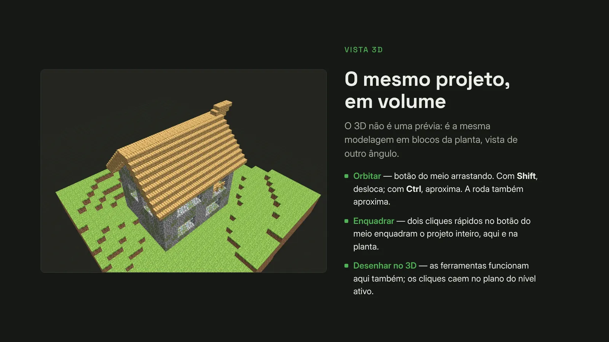

# mCAD

*MineCAD é o nome do projeto; **mCAD 27** é o nome do programa.*

BIM simplificado para projetar arquitetura de Minecraft. Desenha-se em planta com
elementos de verdade — paredes com tipo e camadas, pisos, pilares, vigas, coberturas,
escadas, portas, janelas, alçapões, paredes-cortina, terreno — e o programa discretiza
tudo em blocos do jogo. A mesma conversão alimenta a vista 3D, os cortes, as tabelas
quantitativas e a exportação, então o que aparece na tela é exatamente o que sai no mundo.

**O aplicativo é um arquivo só.** `index.html` não tem dependência de build nem de
servidor: abrir o arquivo no navegador já é o programa inteiro rodando.

👉 **[Abrir no navegador](https://elnata001.github.io/minecad/)** · **[Baixar o mCAD 27 para Windows](https://github.com/Elnata001/minecad/releases/latest)**

## Manual

Um passeio ilustrado pela interface, da primeira parede à exportação para o jogo, em
23 páginas. As imagens são de um projeto real feito no programa — a **Casa de exemplo**:
três níveis, cobertura de quatro águas, escada em L, grupos de blocos e terreno modelado.

📖 **[Ler o manual](MANUAL.md)** · **[versão em página](https://elnata001.github.io/minecad/docs/manual/)**

[](MANUAL.md)

Cobre a janela e as ferramentas, níveis e vistas, planta, fachadas e 3D, a modelagem de
escadas e coberturas, os tipos, o anexar topo, o terreno, componentes e grupos, as tabelas
quantitativas, a exportação, os arquivos `.mcad` e os atalhos de teclado.

## O que tem dentro

- **Modelagem em planta** com métodos de desenho (linha, retângulo, polígono, círculo,
  arco, curva), tipos de parede por camadas, componentes e grupos reutilizáveis.
- **Topografia** como superfície matemática: TIN por Delaunay a partir de pontos cotados,
  linhas de ruptura e plataformas, com curvas de nível, hipsometria, perfis de corte e
  conversão em blocos para o jogo.
- **Importação de terreno** por levantamento em CSV ou por recorte do mundo do Minecraft
  (`.mca`, `.nbt` do bloco de estrutura, `.schem` do WorldEdit), lido no próprio navegador.
- **Vista 3D** com texturas do seu próprio pacote de recursos, se você tiver o jogo.
- **Tabelas quantitativas** por elemento e por bloco, e exportação para o Minecraft Java
  com estados de bloco explícitos.

## Organização

| caminho | o que é |
|---|---|
| `index.html` | o aplicativo inteiro |
| `MANUAL.md`, `docs/manual/` | o manual ilustrado e as imagens das 23 páginas |
| `tests/` | ~120 suítes Playwright, o arnês e o duplê do Three.js usado offline |
| `tests/run.sh` | roda todas as suítes contra o `index.html` deste repositório |
| `tools/mkworld.js` | gera o mundo sintético (região, estrutura e esquema) usado nos testes de importação |
| `desktop/` | invólucro Electron: janela, menu nativo, `.mcad`, pasta de mundos e atualização automática |
| `.github/workflows/` | testes a cada push, publicação no Pages e empacotamento do aplicativo Windows |

## Rodar os testes

```bash
npm i -D playwright && npx playwright install chromium
./tests/run.sh
```

As suítes foram escritas contra caminhos absolutos da máquina de desenvolvimento;
`run.sh` recria esses caminhos antes de rodar, para que o que roda aqui seja byte a
byte o que roda lá. Quatro suítes antigas ficam em `tests/skip.txt`: elas apontam para
APIs internas que mudaram e são mantidas só como referência.

## Aplicativo para Windows

O `desktop/` embrulha o mesmo `index.html` num Electron e o publica como **mCAD 27**, e com isso ganha o que o
navegador não dá: janela que lembra o tamanho, menu nativo, associação do `.mcad`,
leitura direta da pasta `saves` do Minecraft e atualização automática a partir dos
releases deste repositório.

O instalador é compilado pelo próprio GitHub numa máquina Windows a cada tag `v*`,
então não é preciso ter Node para gerar uma versão. Para compilar localmente:

```bash
cd desktop
npm install
npm run dist      # gera desktop/dist/mCAD-27-Setup-<versão>-x64.exe
npm start         # roda sem empacotar
```

## Histórico

A numeração recomeçou em **27.1.0** junto com o nome mCAD 27; antes disso as versões
iam de v98 a v103 sob o nome MineCAD. O histórico de código começa na v98. As versões anteriores existem apenas como versões
do artefato no claude.ai e não puderam ser recuperadas como código. Veja o `CHANGELOG.md`.
